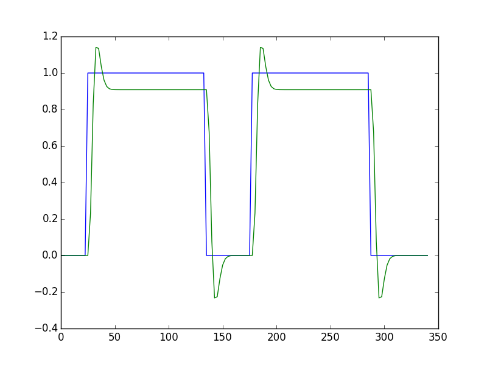

% Project Iota Progress Report
% Zeyu Li, Jie Li, Qingyuan Zhang, Chuan Yun 
% November 12, 2015

## The Paper

We choose "Working memory in healthy and schizophrenic individuals" from OpenFMRI.org, and we are interested in functional brain connectivity, which is known as neural networks. Here are the 4 particular regions of interest (ROIs) in the paper:

- Dorsal fronto-parietal network (FP).
- Cingulo-opercular network (CO).
- Cerebellar network (CER).
- "Default mode" network (DMN).

They showed that individuals with schizophrenia have reduced connectivity between neural networks.

## The Data

The data for this paper has 102 subjects. For each subject, they used fMRI scanning to find blood oxygen level dependent (BOLD) during resting state (R), and after 0-back (0B), 1-back (1B) and 2-back (2B) working memory task. Subjects are in four groups: 

- Individuals with schizophrenia (SCZ).
- Siblings of schizophrenia (SCZ-SIB).
- Healthy controls (CON).
- Siblings of controls (CON-SIB).

Since we don't have time to go through all of the subjects, we choose the first subject from SCZ group. If we have time, we will work on another subject from CON group and do a comparison between these two.

## Data 

We downloaded data from OpenFMRI.org and looked through all the files it has. We found that "ds115_sub001-005.tgz" contains the brain image of the subject we chose. 

- First, we checked all the files in it and found there are three tasks for our subject. 
- Second, we found that under each task there are four brain images. We thought one of them should be the raw image and the others were some-how processed by the authors. 
- Then, we plotted these four brain images and chose the most blurred one (This is probably because it is after smoothing), which is ``BOLD_mcf_brain.nii''. 

## Convolving with the Hemodynamic Response

Similar to what we did in class, we used HRF function to convolve our neural prediction, This will give us a hemodynamic prediction, under the linear-time-invariant assumptions of the convolution. This is a very important step because we will use convolution data in our linear modeling process in the future. Here is the comparison between the original neural prediction and convolved.

## Simplified Objectives

The paper's objective is finding connectivity within and between each ROI on different tasks. They extracted these ROIs and worked directly on them. Since we do not have the knowledge about partition the brain into ROIs, we could not do the same analysis as them. Therefore, we will simply focus on the entire brain and find the region related to these tasks. 

# Current Analysis Progress

## Hemodynamic Function (HDF)

1. HDF for Block Design
	1. Assuming a $h(t)$ for IRF to an instantaneous stimulus
	2. For each block, $h(t)$ is convolved with stimulus timing and duration ($d$) to get idealized response (temporal pattern) as an explanatory variable (regressor): BLOCK($d$, $p$)
		- Linearity assumed within each block: plateau-like response
2. HDF for Event-Related Design
	1. $h(t)$ for IRF to an instamntaneous stimulus
	2. For multiple events of a condition/task, $h(t)$ is convolved with stimulus timing to get idealized response (temporal pattern) as an explanatory variable (regressor): GAM($p$, $q$)
		- Linearity assumed when events are close with each other: overlapping impulse responses

## Linear Model (Basic Idea)

1. Regression: relationship between a response/outcome (dependent) variable and one or more explanatory (independent) variables (regressors).
2. Simple Regression (Linear Model) : fit data with a straight line.
3. Mathematical Model (GLS):
	- $\bold{y} = \bold{X} \boldsymbol{\beta} + \boldsymbol{\epsilon}, \bold{X} = [1, x_1, x_2, ..., x_k]$ 
	- Assumptions:
		+ Linearity
		+ The conditional variance of the error term given $\bold{X}$ is a known matrix $\boldsymbol{\Omega}$.
		+ $E [ \boldsymbol{\epsilon} | \bold{X} ] = 0$, $Var [ \boldsymbol{\epsilon} | \bold{X} ] = \boldsymbol{\Omega}$

4. Solution for linear regression $\bold{y} = \bold{X} \boldsymbol{\beta} + \boldsymbol{\epsilon}$:
	- Project data $\bold{y}$ onto the space of explanatory variables ($\bold{X}$)
	- Generalized Least Square: $\hat{\boldsymbol{\beta}} = (\bold{X}^T \boldsymbol{\Omega}^{-1} \bold{X})^{-1} \bold{X}^T \boldsymbol{\Omega}^{-1} \bold{Y}$ 
	- Student t-test for each $\beta_i   (H_0: \beta_i = 0, i = [1, 2, ..., k]$

##FMRI Data Decomposition

1. FMRI Data = Signal + Noise
	- Data = acquisition from scanner (voxel-wise time series)
	- Signal = BOLD response to stimulus; effects of interest + no interest
		+ We don't really know the real signal 
		+ Of interest: effect size (response amplitude) for each condition: beta
		+ Of no interest: baseline, slow drift, discrete cosine transformation
	- Noise = components in data that interfere with signal
		+ noise is the part we can't explain in the modelm
		+ Making Normality assumptions about its distribution
2. Data = $constant + slow drift + other$ $effects$ $of$ $no$ $interest + response_1 + ... + response_k + noise$
   - Based on this data decomposition, we make our design matrix and model BOLD signals. 

## Design Matrix

1. Voxel-wise (massively univariate) linear model: $\bold{y} = \bold{X} \boldsymbol{\beta} + \boldsymbol{\epsilon}$
	- $\bold{X}$: explanatory variables (regressors), same across voxels
	- $\bold{y}$: data (time series) at a voxel, different across voxels
	- $\boldsymbol{\beta}$: regression coefficients (effects), different across voxels
	- $\boldsymbol{\epsilon}$: anything we can't account for, different across voxels

## Design Matrix (Block Design)
Design Matrix with block design condition
Convolving with the Hemodynamic Response

## Localizing Activation (p-values)

## Localizing Activation (visualization)

## Design Matrix (Mixed Design)

Design Matrix with baseline, convolved conditions, and drifts

## Temporal Smoothing

## Temporal Smoothing

## DCF

## Guassian smoothing

## Localizing Activation 

## Localizing Activation 

## Normality assumption

Shaprio-Wilk's test

## Last week's plan

-F-test 

## Difficulties
- come up with ideal design matrix.
- Interpret analysis results.

